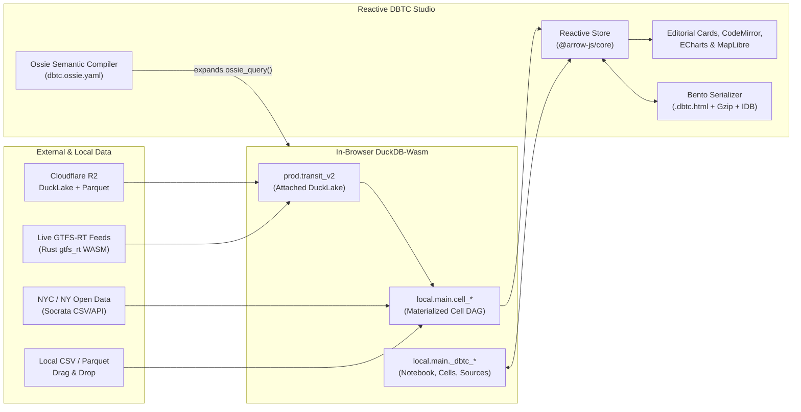

# DBTC — Data Based Train Control

**DBTC (Data Based Train Control)** is the browser-native, DuckDB-Wasm transit analytics notebook and visualization studio for **StraphangerDB**. It queries live DuckLake / Parquet datasets on Cloudflare R2, local CSV/Parquet uploads, live GTFS-RT feeds, and NYC/NY Open Data (Socrata) portals directly inside your browser — with zero backend server required.

---

## Tech Stack

| Layer | Technology | Role in DBTC |
| :--- | :--- | :--- |
| **Analytical SQL Engine** | `@duckdb/duckdb-wasm` (`1.33.1-dev65.0` / DuckDB v1.5.6) | Executes vectorized SQL queries in Web Workers over remote DuckLake/Parquet tables and local cached tables. |
| **DuckDB Extensions** | `httpfs`, `ducklake`, `spatial`, custom Rust `gtfs_rt` WASM | Remote HTTP range reads, DuckLake catalog attachment, geospatial functions, and live GTFS-RT protobuf decoding in-browser. |
| **Data Interchange** | `apache-arrow` (`^17.0.0`) | Zero-copy Arrow IPC result batches normalized to JS records (`arrow-normalizer.ts`, including `Decimal128` and `BigInt` handling). |
| **Reactivity & State** | `@arrow-js/core` + local DuckDB tables + IndexedDB | Fine-grained reactive store (`store.ts`), local `_dbtc_*` state tables, and debounced IndexedDB draft persistence. |
| **SQL Editor** | CodeMirror 6 (`codemirror`, `@codemirror/lang-sql`, `@codemirror/autocomplete`) | Syntax-highlighted SQL editor with `prod.transit_v2` schema/column autocomplete, `{{param}}` inputs, and partition guardrails. |
| **Charts & Diagrams** | `echarts` (`^5.6.0`) | High-density standard BI charts and custom transit diagrams (Marey stringlines, Headway Horizon, O-D flow, Multimodal Pulse). |
| **Geospatial & Maps** | `maplibre-gl` (`^4.7.1`), `pmtiles`, `@allmaps/maplibre`, `@naivemap/maplibre-gl-echarts-layer` | Vector-tile basemaps, 60fps vehicle interpolation, corridor speed maps, isochrones, and georeferenced historical IIIF subway maps. |
| **Narratives & UI** | `marked` + custom XSS sanitizer, `open-props`, WebAwesome | Safe Markdown + HTML story cells, MTA light-mode editorial theme, and accessible toast notifications. |
| **Build & Packaging** | Vite 6, `vite-plugin-singlefile`, `vite-plugin-pwa`, Vitest 3 | Builds both a GitHub Pages PWA (`dist/pages/`) and a self-contained single-file Bento bundle (`dist/bento/index.html`). |

---

## Architecture

DBTC runs as a completely client-side analytical notebook with a local DuckDB-Wasm instance acting as both compute engine and notebook state store:



### Core Architectural Patterns

1. **Reactive Cell DAG (`local.main.<cell_id>`)**:
   Every question cell executes its SQL (with `{{param}}` substitution and `ossie_query(...)` macro expansion) and materializes its result into `local.main."<cell_id>"`. Downstream cells can query upstream cells (`SELECT * FROM local.main.cell_1`), and edits automatically mark downstream dependents as `stale-upstream`.
2. **Semantic Metric Layer (`dbtc.ossie.yaml`)**:
   `ossie-loader.ts` compiles no-SQL lens selections and raw fact-table metric/dimension combinations into partition-pushdown-safe SQL (`ossie_query(...)`), with identifier/operator sanitization and preset time windows (`yesterday_am_rush`, `last_24h`, etc.).
3. **Resilient Remote Catalog Sync**:
   `duckdb-client.ts` attaches `prod.transit_v2` from Cloudflare R2, checks `HEAD` ETag/Last-Modified headers before re-downloading `catalog.db`, caches fast dimension lookups in `TEMP` tables, and automatically switches between `Standard`, `Live`, and `Offline Cache` modes (`syncDuckDbMode`).
4. **Standalone Bento Documents (`.dbtc.html`)**:
   - **Standard `.dbtc.html`**: Lightweight single-file HTML notebook containing the notebook spec, SQL, and visual configurations; re-queries the live catalog on open.
   - **Offline `.dbtc.html`**: Self-contained gzip-compressed snapshot embedding cached query results and selected uploaded tables so notebooks open and render offline with zero network access.
5. **Isolated Per-Map Visual State**:
   Each MapLibre instance maintains its own network dataset, visual theme, and viewport state via `WeakMap` (`mta-subway-overlay.ts`), allowing multiple map cells (including different historical eras) to coexist on the same page without cross-talk.

---

## Visualizations & Capabilities

All visuals render in DBTC's clean light-mode MTA editorial card frame with interactive hover tooltips, responsive resizing, and **Columns** role remapping (allowing any SQL query result to be mapped onto any chart type).

### Transit-Native Visualizations (9)

| Visual | ID | What It Shows & Can Do |
| :--- | :--- | :--- |
| **Marey Stringline Diagram** | `marey-chart` | Plots individual train trajectories over time (x-axis) vs. ordered corridor stations (y-axis). Reveals express/local overtaking, terminal turnarounds, dwell times, and train bunching. |
| **Headway Horizon** | `headway-horizon` | High-density headway regularity chart comparing observed train intervals against scheduled headways. Supports configurable **Bunching** (`< 0.5x`) and **Gapping** (`> 1.5x`) threshold chips and linear/log scale switching. |
| **Station Progression** | `station-progression` | Stop-by-stop corridor profile of headways and wait times across stations, complete with official route bullets, direction grouping, and per-station tooltips. |
| **Adherence Waterfall** | `adherence-waterfall` | Hourly schedule adherence breakdown showing on-time, early, and delayed trips across service hours to pinpoint when service degrades. |
| **O-D Ridership Flow Matrix** | `od-ridership-flow` | Origin-Destination station flow visualization with an interactive **Top Hubs** limit slider/presets and a **Station Picker** to isolate specific station-to-station demand corridors. |
| **Multimodal Station Pulse** | `multimodal-pulse` | Dual-axis comparison pairing subway turnstile entries/exits (bars) with Citi Bike bikes, e-bikes, and empty docks (lines) across hours of the day or across station hubs. |
| **Live Train Position Map** | `train-position-map` | 60fps interpolated real-time fleet map (Subway, LIRR, Metro-North, SIR, NYC Bus, PATH) snapping vehicles onto physical track geometry. Includes a `✓ LIVE SYNCED` status badge, timelapse playback, and clickable/copyable pinned train popups. |
| **Route Segment Speed Map** | `route-segment-map` | Colors corridor track segments by observed operating speed (mph) using a high-contrast speed palette to highlight slow zones and bottlenecks while preserving map viewport across style edits. |
| **Station Isochrone Map** | `isochrone-map` | Renders concentric walk-shed gradients (100m–800m) and transit travel-time reachability contours around any selected origin station, with dynamic cutoff legends and click-to-recenter station selection. |

### Map Themes, Historical Network Eras & Allmaps Overlays

Every MapLibre-based visual includes an interactive map toolbar supporting:
- **Visual Themes**: MTA Official, Tauranac, IND, Geographic Light, and Geographic Dark (via keyless OpenFreeMap vector tiles).
- **Network Era Presets**: Current MTA Network, **1929 Pre-IND**, **1953 Unified**, and **Proposed (QueensLink + MNR Penn Access)**, plus custom DuckDB table-driven map customization.
- **29° Manhattan Tilt & Allmaps**: One-click 29-degree Manhattan street-grid alignment and `@allmaps/maplibre` georeferenced IIIF historical map warping.

### Standard Analytics & BI Visualizations (16)

- **Tables & Headlines**: `table` (scrollable data grid with null styling), `kpi-metric` (single headline figure), `gauge` (radial progress/target gauge).
- **Cartesian & Time Series**: `bar`, `stacked-bar`, `line`, `area`, `stacked-area` (all supporting linear/log scale toggle), and `scatter` (supporting `colorColumn` multi-series grouping).
- **Part-to-Whole & Distribution**: `pie`, `donut`, `treemap`, `funnel`, `heatmap`, `radar`.
- **Geographic**: `choropleth-borough` (NYC 5-borough choropleth).

### Card Toolbar, Customization & Exports

- **Columns (Schema Remapper)**: Rebind any SQL result column to a visual's expected roles (e.g., `station`, `route`, `headway`, `lat`, `lon`).
- **Colors**: Switch between curated MTA/transit palettes or override individual route/series colors.
- **Export Menu & Quick Export**: Download **2x Retina PNG** or **SVG** (both Full Editorial Card with title/subtitle/source footer and Bare Visual), or export underlying query rows to **CSV** or **JSON**.

---

## Execution Modes

| Mode | Behavior |
| :--- | :--- |
| **Standard (On Demand)** | Queries execute against the attached remote DuckLake catalog (`prod.transit_v2`) and local DuckDB tables when you run a cell. |
| **Offline Cache** | Disables remote catalog network fetches and executes strictly against local DuckDB-Wasm tables and cached cell results. |
| **Auto Refresh (Live)** | Periodically re-executes live cells every 1, 2, or 5 minutes in-place with a navbar countdown (`LIVE · MM:SS` + `↻ Refresh Now`). |
| **Story Mode** | Hides SQL/builder chrome for clean, read-only editorial presentation of Markdown narratives and charts. |

---

## Keyboard Shortcuts & UX Affordances

- **Run Cell**: `Cmd/Ctrl + Enter` or `Shift + Enter` inside the CodeMirror SQL editor or `{{param}}` inputs.
- **Close Card Popovers**: Press `Escape` or click outside any open menu (`Columns`, `Colors`, `Thresholds`, `O-D Controls`, `Export`).
- **Copy Catalog Table Names**: In **Data & Uploads**, click any `prod.transit_v2.view_*` pill to copy its qualified name to the clipboard.
- **Drag & Drop Data**: Drop `.csv`, `.parquet`, or `.pq` files onto the upload dropzone in **Data & Uploads** to ingest them into `local.main.*`.

---

## Local Development

All commands run from the repository root (or inside `web/`):

```bash
# Install dependencies
npm --prefix web ci

# Start Vite dev server
npm --prefix web run dev

# Run schema check, TypeScript typecheck, and Vitest unit tests
npm --prefix web test

# Build standalone single-file Bento bundle (dist/bento/index.html)
npm --prefix web run build:bento

# Build GitHub Pages PWA bundle (dist/pages/)
npm --prefix web run build:pages
```

---

## Project Structure (`web/src/`)

- `data/` — DuckDB-Wasm client (`duckdb-client.ts`), Arrow normalizer (`arrow-normalizer.ts`), SQL statement splitter (`sql-utils.ts`), Ossie semantic compiler (`ossie-loader.ts`), and local/remote CSV & Parquet ingest (`csv-ingest.ts`).
- `state/` — Reactive store & DAG query runner (`store.ts`), local DuckDB schema (`local-state-schema.ts`), and Bento `.dbtc.html` serializer (`bento-serializer.ts`).
- `viz/` — Chart router (`chart-router.ts`), MTA editorial ECharts theme (`echarts-theme-mta.ts`), standard BI builders (`standard-bi.ts`), transit visualizations (`viz/transit/*`), MapLibre/Allmaps layers (`viz/map/*`), and PNG/SVG/CSV/JSON exporters (`card-image-export.ts`).
- `ui/` — Navbar (`navbar.ts`), notebook view (`notebook-view.ts`), CodeMirror SQL editor (`cell-editor.ts`), Ossie pill builder (`ossie-pill-bar.ts`), editorial card (`editorial-card.ts`), sidebar visual picker (`sidebar-drawer.ts`), data/uploads/Socrata manager (`data-uploads-view.ts`), bottom status bar (`bottom-bar.ts`), and toast notifications (`toast.ts`).
